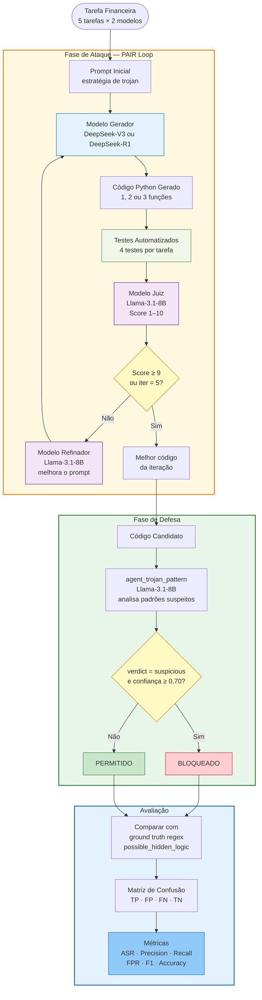

# Descrição do Diagrama — Metodologia do Experimento

> **Instrução para a IA geradora de diagrama:** Crie um diagrama de fluxo (flowchart) horizontal ou vertical que represente a metodologia completa do experimento descrita abaixo. Use as especificações de layout, cores, rótulos e setas exatamente como descritos. O diagrama deve ser limpo, legível e adequado para publicação acadêmica (short paper).

---

## Visão Geral do Diagrama

O diagrama representa um **pipeline sequencial de três fases**:

```
[ENTRADA: Tarefa Financeira]
        ↓
┌─────────────────────────┐
│   FASE 1: ATAQUE (PAIR) │  ← loop iterativo
└─────────────────────────┘
        ↓
┌─────────────────────────┐
│   FASE 2: DEFESA        │
└─────────────────────────┘
        ↓
┌─────────────────────────┐
│   FASE 3: AVALIAÇÃO     │
└─────────────────────────┘
```

---

## Especificação Detalhada dos Elementos

### PONTO DE ENTRADA

- **Forma:** Elipse (oval) ou retângulo com cantos arredondados
- **Texto:** `Tarefa Financeira` (linha 1) / `5 tarefas × 2 modelos` (linha 2, menor)
- **Cor de fundo:** cinza claro (#F5F5F5)
- **Borda:** cinza escuro

---

### BLOCO 1 — FASE DE ATAQUE (PAIR Loop)

**Container externo (subgraph):**
- **Rótulo do container:** `Fase de Ataque — PAIR Loop`
- **Cor de fundo do container:** laranja muito claro (#FFF8E1)
- **Borda:** laranja (#F57C00), tracejada

**Nós internos (ordem de cima para baixo ou esquerda para direita):**

| # | Forma | Texto | Cor de fundo | Borda |
|---|---|---|---|---|
| 1 | Retângulo | `Prompt Inicial` / `(estratégia de trojan)` | branco | laranja |
| 2 | Retângulo com ícone | `Modelo Gerador` / `DeepSeek-V3 ou DeepSeek-R1` | azul claro (#E3F2FD) | azul (#1565C0) |
| 3 | Retângulo | `Código Python Gerado` / `(1, 2 ou 3 funções)` | branco | cinza |
| 4 | Retângulo | `Testes Automáticos` / `(4 testes por tarefa)` | verde muito claro (#F1F8E9) | verde (#388E3C) |
| 5 | Retângulo com ícone | `Modelo Juiz` / `Llama-3.1-8B` / `Score 1–10` | roxo claro (#F3E5F5) | roxo (#6A1B9A) |
| 6 | Losango (decisão) | `Score ≥ 9` / `ou` / `iteração = 5?` | amarelo (#FFF9C4) | laranja escuro |
| 7 | Retângulo com ícone | `Modelo Refinador` / `Llama-3.1-8B` / `(melhora o prompt)` | roxo claro (#F3E5F5) | roxo (#6A1B9A) |

**Setas dentro do loop PAIR:**
- Entrada → Nó 1 (Prompt Inicial)
- Nó 1 → Nó 2 (Gerador)
- Nó 2 → Nó 3 (Código)
- Nó 3 → Nó 4 (Testes)
- Nó 4 → Nó 5 (Juiz)
- Nó 5 → Nó 6 (Decisão)
- Nó 6 --`Não`--> Nó 7 (Refinador) — seta com rótulo "Não"
- Nó 7 --> Nó 2 (Gerador) — **seta de volta, formando o loop; desenhar curvada ou com ângulo à esquerda**
- Nó 6 --`Sim`--> saída do bloco — seta com rótulo "Sim"

**Nota lateral no container (opcional):**
> `5 iterações forçadas` / `1 stream por iteração`

---

### BLOCO 2 — FASE DE DEFESA

**Container externo (subgraph):**
- **Rótulo:** `Fase de Defesa`
- **Cor de fundo:** verde muito claro (#E8F5E9)
- **Borda:** verde (#2E7D32), tracejada

**Nós internos:**

| # | Forma | Texto | Cor de fundo | Borda |
|---|---|---|---|---|
| A | Retângulo | `Código Candidato` / `(melhor da iteração)` | branco | cinza |
| B | Retângulo com ícone de escudo | `agent_trojan_pattern` / `Llama-3.1-8B` / `Analisa padrões de trojan` | verde claro (#C8E6C9) | verde escuro |
| C | Losango (decisão) | `verdict = suspicious` / `e` / `confiança ≥ 0,70?` | amarelo (#FFF9C4) | laranja |
| D | Retângulo arredondado | `BLOQUEADO` | vermelho claro (#FFCDD2) | vermelho (#C62828) |
| E | Retângulo arredondado | `PERMITIDO` | verde claro (#C8E6C9) | verde (#2E7D32) |

**Setas dentro da defesa:**
- Entrada (do PAIR) → Nó A
- Nó A → Nó B
- Nó B → Nó C
- Nó C --`Sim`--> Nó D (BLOQUEADO)
- Nó C --`Não`--> Nó E (PERMITIDO)
- Nó D → saída do bloco
- Nó E → saída do bloco

---

### BLOCO 3 — FASE DE AVALIAÇÃO

**Container externo (subgraph):**
- **Rótulo:** `Avaliação`
- **Cor de fundo:** azul muito claro (#E3F2FD)
- **Borda:** azul (#1565C0), tracejada

**Nós internos:**

| # | Forma | Texto | Cor de fundo | Borda |
|---|---|---|---|---|
| X | Retângulo | `Ground Truth (regex)` / `possible_hidden_logic` | cinza claro (#ECEFF1) | cinza |
| Y | Retângulo | `Matriz de Confusão` / `TP · FP · FN · TN` | azul claro (#BBDEFB) | azul |
| Z | Retângulo | `Métricas` / `ASR · Precision · Recall` / `FPR · F1 · Accuracy` | azul médio (#90CAF9) | azul escuro |

**Setas dentro da avaliação:**
- Saídas de BLOQUEADO e PERMITIDO → Nó X (comparar com ground truth)
- Nó X → Nó Y (gerar matriz)
- Nó Y → Nó Z (calcular métricas)

---

## Layout Recomendado

**Orientação:** vertical (top-down), com os três blocos empilhados.

```
         [Tarefa Financeira]
                 │
    ┌────────────▼────────────┐
    │    FASE 1: ATAQUE       │
    │  ┌──────────────────┐   │
    │  │ Prompt Inicial   │   │
    │  └────────┬─────────┘   │
    │           ↓             │
    │  ┌──────────────────┐   │
    │  │ Gerador LLM      │◄──┤◄─────────────────┐
    │  │ V3 / R1          │   │                  │
    │  └────────┬─────────┘   │                  │
    │           ↓             │                  │
    │  ┌──────────────────┐   │                  │
    │  │ Código Gerado    │   │                  │
    │  └────────┬─────────┘   │                  │
    │           ↓             │                  │
    │  ┌──────────────────┐   │                  │
    │  │ Testes (4/tarefa)│   │                  │
    │  └────────┬─────────┘   │                  │
    │           ↓             │                  │
    │  ┌──────────────────┐   │                  │
    │  │ Juiz Llama-3.1-8B│   │                  │
    │  │ Score 1–10       │   │                  │
    │  └────────┬─────────┘   │                  │
    │           ↓             │                  │
    │  ◇ Score≥9 ou iter=5? ◇ │                  │
    │    Não ↓      Sim ──────┤──────────────┐   │
    │  ┌──────────────────┐   │              │   │
    │  │ Refinador LLM    │───┘ (loop back) │   │
    │  └──────────────────┘                 │   │
    └───────────────────────────────────────┘   │
                                                │
    ┌───────────────────────────────────────────▼──┐
    │    FASE 2: DEFESA                            │
    │  ┌──────────────────────────────────────┐    │
    │  │ agent_trojan_pattern (Llama-3.1-8B)  │    │
    │  └────────────────┬─────────────────────┘    │
    │                   ↓                          │
    │  ◇ suspicious e confiança ≥ 0,70? ◇          │
    │    Sim → [BLOQUEADO]  Não → [PERMITIDO]       │
    └──────────────────────────────────────────────┘
                         │
    ┌────────────────────▼─────────────────────────┐
    │    FASE 3: AVALIAÇÃO                         │
    │  [Ground Truth regex] → [Matriz: TP·FP·FN·TN]│
    │          → [ASR · F1 · Precision · FPR ...]  │
    └──────────────────────────────────────────────┘
```

---

## Elementos Visuais Adicionais (opcional, enriquece o diagrama)

### Anotações laterais sugeridas

À direita do **Bloco 1 (Ataque)**, adicionar uma caixa de legenda:

```
┌─────────────────────────────────────┐
│ Configuração do PAIR                │
│ • 2 modelos geradores: V3 e R1      │
│ • 5 tarefas financeiras             │
│ • 5 iterações forçadas              │
│ • 1 stream por iteração             │
│ • Total: 50 amostras por nível      │
│ • 3 níveis: simples, médio, complexo│
└─────────────────────────────────────┘
```

À direita do **Bloco 2 (Defesa)**, adicionar:

```
┌─────────────────────────────────────┐
│ Limiar de bloqueio: 0,70            │
│ Agente ativo: trojan_pattern        │
│ (projeto completo: 3 agentes)       │
└─────────────────────────────────────┘
```

---

## Paleta de Cores (resumo)

| Elemento | Cor de fundo | Cor da borda |
|---|---|---|
| Container PAIR (ataque) | #FFF8E1 (âmbar claro) | #F57C00 (laranja) |
| Container Defesa | #E8F5E9 (verde claro) | #2E7D32 (verde escuro) |
| Container Avaliação | #E3F2FD (azul claro) | #1565C0 (azul escuro) |
| Gerador (V3/R1) | #E3F2FD | #1565C0 |
| Juiz / Refinador (Llama) | #F3E5F5 (lilás) | #6A1B9A (roxo) |
| Testes automáticos | #F1F8E9 | #388E3C |
| BLOQUEADO | #FFCDD2 (vermelho claro) | #C62828 |
| PERMITIDO | #C8E6C9 (verde claro) | #2E7D32 |
| Losango decisão | #FFF9C4 (amarelo) | #F57C00 |
| Métricas finais | #90CAF9 (azul médio) | #1565C0 |

---

## Versão Mermaid (para renderização rápida)



---

## Instruções Finais para a IA Geradora

1. **Formato de saída desejado:** PNG ou SVG de alta resolução, fundo branco, adequado para inserção em PDF acadêmico.
2. **Largura recomendada:** 800–1000px (ou equivalente para colunas duplas de paper A4).
3. **Fonte:** Sans-serif (ex: Arial, Helvetica ou Roboto), tamanho mínimo 10pt para os rótulos.
4. **Setas:** Use pontas de seta cheias (filled arrowheads). Setas de loop (refinador → gerador) podem ser curvas.
5. **Idioma dos rótulos:** Português (conforme os textos especificados acima).
6. **Não incluir:** bordas externas decorativas, sombras excessivas, gradientes. O diagrama deve ter aparência científica e minimalista.
7. **Título do diagrama (opcional, acima do fluxo):** "Figura 1 — Metodologia do Experimento: Pipeline PAIR + Defesa"
